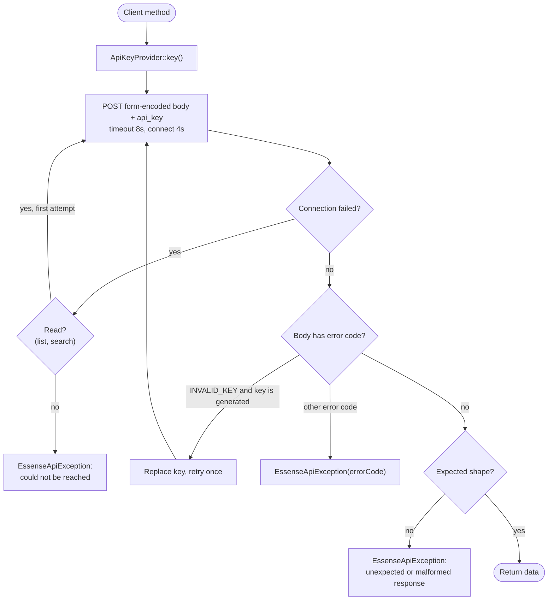
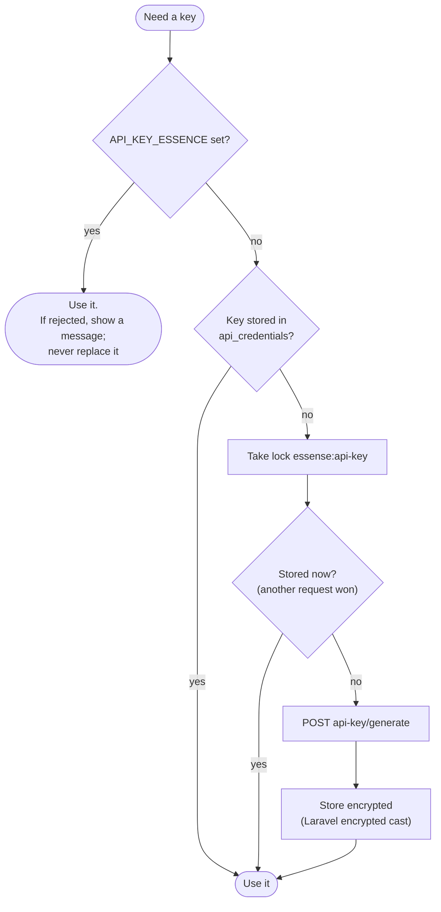

# API integration

The app uses the [Essense code challenge API](https://codechallenge.essensedesigns.info/docs)
through one class, `App\Services\Essense\EssenseClient`. Nothing else makes HTTP calls to it.

## Endpoints used

| Client method    | Endpoint                | Used by                                     |
| ---------------- | ----------------------- | ------------------------------------------- |
| `games()`        | `POST games/list`       | Library page, duplicate check, `games:seed` |
| `find(id)`       | `POST games/search`     | (available; not on a hot path)              |
| `add(name)`      | `POST games/add`        | `AddGame`, `games:seed`                     |
| `remove(id)`     | `POST games/remove`     | `RemoveGame`                                |
| `vote(id)`       | `POST games/vote`       | `CastVote`, `games:seed`                    |
| `removeVote(id)` | `POST games/removeVote` | `RemoveVote`                                |
| key generation   | `POST api-key/generate` | `ApiKeyProvider` (see below)                |

`GET lastGameId`, `POST cache/flush` and `GET cache/health` are not used by the app.

## Behaviour found by probing

The docs list request parameters and happy-path responses. These were found by calling the API:

| Behaviour                                                                                                                                                  | How the client handles it                                                                                |
| ---------------------------------------------------------------------------------------------------------------------------------------------------------- | -------------------------------------------------------------------------------------------------------- |
| Bodies must be `application/x-www-form-urlencoded`; a JSON body gets `MISSING_KEY`                                                                         | Every request uses `asForm()`                                                                            |
| Most failures return **HTTP 200** with a placeholder: `{}` (unknown id), `{"success": false}` (vote/remove on a missing game), `{"id": -1}` (rejected add) | Responses are checked by shape, not status. `add()` throws on `id < 1`; `vote()`/`remove()` return false |
| Key problems return `{"error": "MISSING_KEY" \| "INVALID_KEY"}` with 400/403                                                                               | Thrown as `EssenseApiException` with `errorCode` set                                                     |
| The list comes back in id order, not by votes                                                                                                              | The controller sorts by votes, then name                                                                 |
| Duplicate names are accepted                                                                                                                               | The app rejects duplicates itself                                                                        |
| Removing a vote at 0 reports success; the count stays 0                                                                                                    | Local `votes` rows stop this from mattering                                                              |
| Ids are never reused within a key's library, but restart at 1 for each key                                                                                 | Local data is tied to a key fingerprint                                                                  |
| Keys stop working when the API server restarts                                                                                                             | Generated keys are replaced automatically                                                                |
| `GET /api-key` returns an HTML page despite the docs; the page's script calls `POST /api-key/generate` → `{"key": "..."}`                                  | Used for key generation                                                                                  |
| Concurrent writes can be lost: of 500 adds sent 16 at a time, 4–10% never appeared                                                                         | Adds are serialised behind a lock                                                                        |

## Request handling

- **Only reads are retried.** Retrying `games/vote` after a timeout could count one vote twice.
- **Retrying after `INVALID_KEY` is safe** because a rejected request changed nothing.
- **Untrusted data is validated:** `GameData::fromArray()` rejects games without a numeric id, a
  string name and numeric votes.

## API key management

- **The key never reaches the browser.**
- **Stored keys are encrypted** with `APP_KEY`. If `APP_KEY` changes, the stored key can't be
  decrypted; it is treated as missing and a new one is generated (a fresh, empty library).
- **When the active key changes** for any reason (generated replacement, `.env` edit, switching
  between them), the [fingerprint check](data-model.md#keeping-sqlite-in-step-with-the-api)
  discards local votes, because their game ids now refer to a different library.

## Error messages users see

| Cause                                                       | Message                                                                                                                                           |
| ----------------------------------------------------------- | ------------------------------------------------------------------------------------------------------------------------------------------------- |
| API unreachable, 5xx, malformed data, key generation failed | "The game library is not responding right now. Please try again in a moment."                                                                     |
| `.env` key rejected                                         | "The game library rejected the API key in API_KEY_ESSENCE. Update it in .env, or remove it to let the app get its own key, then restart the app." |
| Vote/remove on a game that's gone                           | "That game is no longer in the library. The list has been refreshed."                                                                             |
| Another add holds the lock for over 5s                      | "Another game is being added right now. Please try again."                                                                                        |

The library page still renders when the API is down, with the message and a **Try again** button.
Every API failure is passed to `report()` so it reaches the log.
