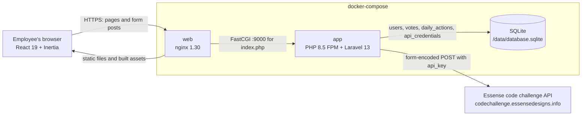
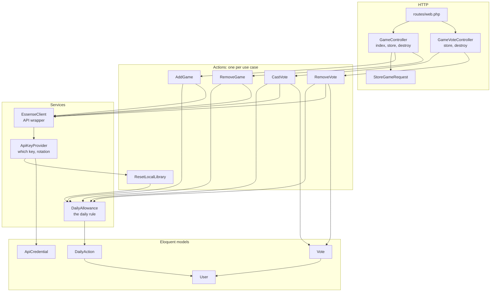
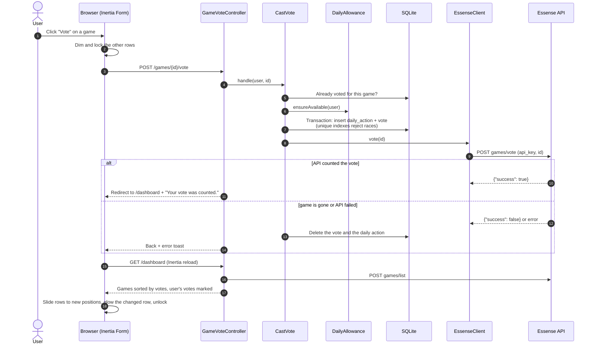

# Architecture

GameVote is a Laravel 13 app on PHP 8.5 with a React 19 + TypeScript front end, connected by
Inertia v3: Laravel controllers return page components and props, and React renders them. Games
and vote totals live in the external Essense code challenge API; SQLite holds users, who voted for
what, and the daily-rule ledger.

## System context

- **nginx** serves `public/` (including the Vite build) and passes PHP requests to PHP-FPM.
- **The app** is the only thing that talks to the API; the key never reaches the browser.
- **SQLite** is a single file in the `sqlite-data` volume, alongside the generated `APP_KEY`.

## Code layers

- **Controllers** stay thin: validate, call an action, flash a toast, redirect.
- **Actions** (`app/Actions/Games`) own one use case each, including the ordering of local writes
  and API calls so a failure leaves both sides consistent.
- **`DailyAllowance`** is the only place that knows the daily rule.
- **`EssenseClient`** is the only place that knows the API's HTTP details.
- **`GameActionException`** carries a message safe to show users and renders itself as an error
  toast; the add-game form turns it into an inline field error instead.

## A request end to end: casting a vote

## Where things live

| Concern                     | Location                                                                                 |
| --------------------------- | ---------------------------------------------------------------------------------------- |
| Routes                      | `routes/web.php`, `routes/settings.php`                                                  |
| Game use cases              | `app/Actions/Games/`                                                                     |
| Daily rule                  | `app/Services/DailyAllowance.php`                                                        |
| API client and key handling | `app/Services/Essense/`                                                                  |
| Auth (Fortify)              | `app/Actions/Fortify/`, `app/Providers/FortifyServiceProvider.php`, `config/fortify.php` |
| Library page                | `resources/js/pages/dashboard.tsx` and `resources/js/components/`                        |
| Sample data                 | `app/Console/Commands/SeedGames.php` (`php artisan games:seed`)                          |
| Docker                      | `Dockerfile`, `docker-compose.yml`, `docker/`                                            |
