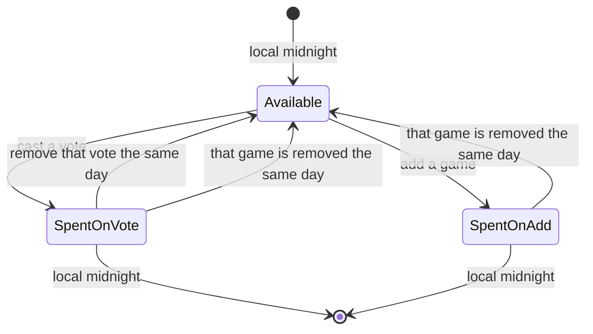
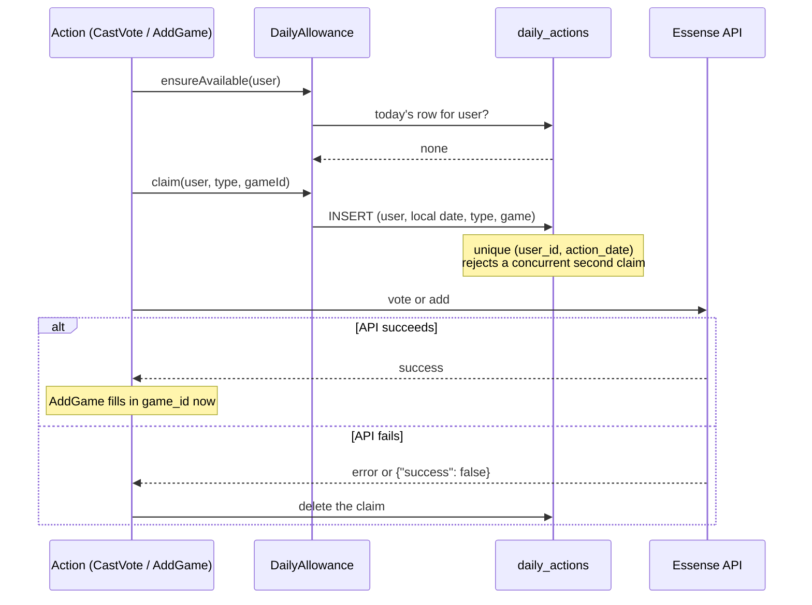

# The daily rule

> A user may cast one vote OR add one new game per day (midnight to midnight, their local time is
> fine). Our API doesn't enforce this, so your backend must.
>
> From the challenge brief.

All of the rule lives in `App\Services\DailyAllowance`, backed by the `daily_actions` table.

## A user's day

- **One action per local day**, a vote or a new game.
- **Refunds follow one rule:** an action comes back only when the thing it was spent on is undone
  on the same local day.
- **Earlier days never refund.** Removing yesterday's vote leaves yesterday's ledger row in place,
  so voting and un-voting across days can't manufacture extra votes.

## How it's enforced

| Layer            | Mechanism                                                                                                                                                                              |
| ---------------- | -------------------------------------------------------------------------------------------------------------------------------------------------------------------------------------- |
| Friendly check   | `ensureAvailable()` looks for today's row and throws `GameActionException::dailyLimitReached()`                                                                                        |
| Race-proof check | A unique index on `(user_id, action_date)`. Two simultaneous requests can both pass the friendly check, but only one insert succeeds; the other is turned into the same friendly error |
| Ordering         | Actions that spend the allowance claim it **before** calling the API and undo the claim if the API call fails, so a failed vote or add never costs the user their day                  |

### Spending and undoing, step by step

## Timezones

- The browser's timezone (`Intl.DateTimeFormat().resolvedOptions().timeZone`) is sent as a hidden
  field at sign-up, validated with Laravel's `timezone:all` rule, and stored on the user. Missing
  values default to the app timezone (UTC).
- "Today" is `now($user->timezone)->startOfDay()`, stored as a plain `Y-m-d` string.
- **It can't be changed later**, so nobody can gain an extra day by switching timezones.
- Dates are compared as `Y-m-d` strings, not with Carbon's `isSameDay()`, which converts timezones
  first and would make a Sydney user's "today" look like yesterday in UTC.

Example, a user in `Australia/Sydney` (UTC+11):

| UTC time     | Sydney time  | Can act?                                         |
| ------------ | ------------ | ------------------------------------------------ |
| 20 Oct 12:30 | 20 Oct 23:30 | Yes (first action of 20 Oct)                     |
| 20 Oct 12:59 | 20 Oct 23:59 | No, 20 Oct is spent                              |
| 20 Oct 13:01 | 21 Oct 00:01 | Yes, a new local day, though UTC is still 20 Oct |

This exact scenario is a test: `tests/Feature/Games/AddGameTest.php`.

## Edge cases

| Situation                                  | What happens                                                         |
| ------------------------------------------ | -------------------------------------------------------------------- |
| Vote, then remove it the same day          | Allowance refunded; the toast says so                                |
| Vote yesterday, remove it today            | Today's allowance is unaffected                                      |
| Someone removes a game you voted for today | Your vote is deleted and today's action refunded                     |
| Someone removes the game you added today   | Today's action refunded                                              |
| The API fails mid-vote or mid-add          | The claim is undone; nothing is spent                                |
| Two tabs vote at the same moment           | The unique index lets one through; the other gets the friendly error |
| The API key changes (new library)          | All local votes are discarded and today's actions on them refunded   |
| An add is in flight when the key resets    | Its claim has no `game_id` yet and is kept, so the add isn't free    |

## Testing switch

`REMOVE_LIMITS=true` in `.env` makes `DailyAllowance::isEnforced()` return false: no ledger rows
are written and the page shows a "limits are off" notice. Duplicate titles and one vote per game
still apply. It is ignored when `APP_ENV=production`, and `phpunit.xml` pins it off.
