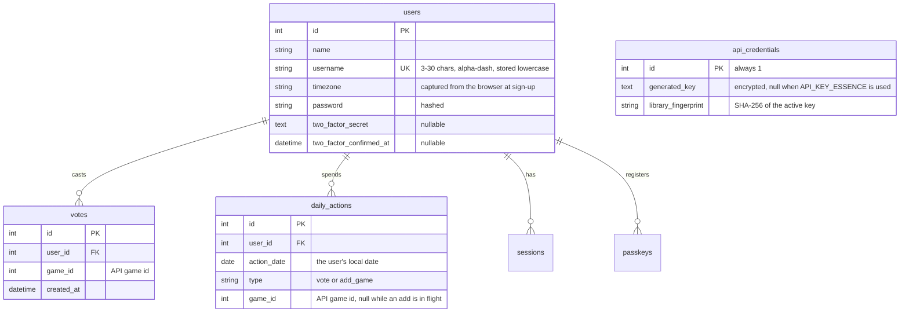
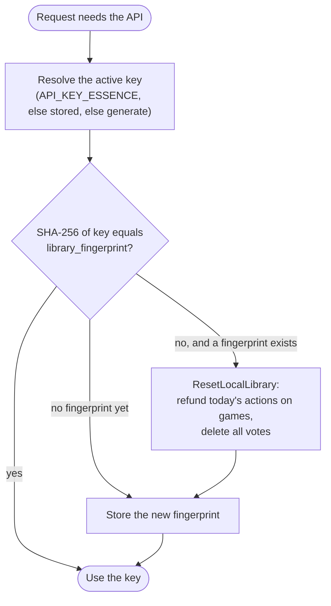

# Data model

The external API and SQLite each hold part of the picture. Neither is complete on its own.

| Data                                                   | Lives in                 | Why                                                                                                                     |
| ------------------------------------------------------ | ------------------------ | ----------------------------------------------------------------------------------------------------------------------- |
| Games (id, name)                                       | API                      | The brief makes the API the backend's persistence for games                                                             |
| Vote totals                                            | API                      | The API keeps a counter per game                                                                                        |
| Who voted for which game                               | SQLite `votes`           | The API's counter has no notion of voters, so users could otherwise remove each other's votes or push counts below zero |
| The daily rule ledger                                  | SQLite `daily_actions`   | The API doesn't enforce the rule; the brief requires a real database                                                    |
| Users                                                  | SQLite `users`           | Username/password accounts via Laravel Fortify                                                                          |
| Which API key, and whose library local data belongs to | SQLite `api_credentials` | Lets `docker-compose up` work without setup, and keeps votes in step with the key                                       |

## Entity relationships

`game_id` columns hold the **API's** game id; there is no local games table. The list of games is
always read from the API.

### Constraints that carry business rules

| Constraint                                                 | Rule it enforces                                                  |
| ---------------------------------------------------------- | ----------------------------------------------------------------- |
| `votes` unique `(user_id, game_id)`                        | One vote per game per user, even under concurrent requests        |
| `daily_actions` unique `(user_id, action_date)`            | One action per user per local day, even under concurrent requests |
| `users` unique `username` (stored lowercase)               | Usernames are unique regardless of case                           |
| `votes.user_id`, `daily_actions.user_id` cascade on delete | Deleting an account removes its local votes and ledger            |

> **Known limitation:** deleting an account removes the user's rows from `votes`, but the API's
> totals still include those votes, and nobody can remove them any more. Fixing it means calling
> `games/removeVote` for each of the user's votes before deleting the account.

## Keeping SQLite in step with the API

Each API key has its own library, and game ids start again at 1 in each. Local `votes` and
`daily_actions` therefore only make sense for the library they were recorded against.
`api_credentials.library_fingerprint` records which one that is.

Earlier days' `daily_actions` rows are kept: they are history, and deleting them would give users
extra actions.

## Framework tables

`sessions`, `cache`, `cache_locks`, `jobs`, `job_batches`, `failed_jobs`, `passkeys` and
`migrations` are standard Laravel/Fortify tables. `cache_locks` backs the two application locks:
`games:add` (serialises game additions) and `essense:api-key` (one key generation at a time).
