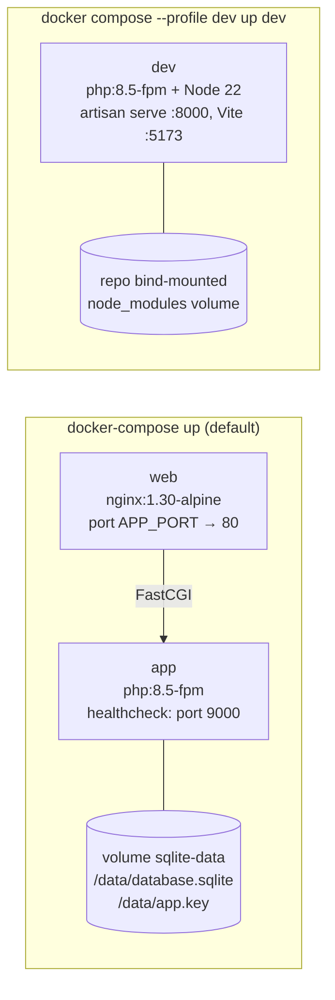
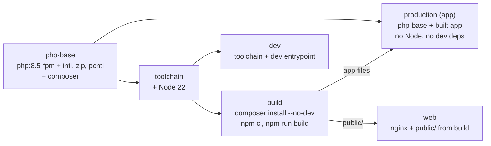

# Deployment

## Docker stacks

`docker-compose.yml` defines two production containers and an opt-in development container.

### How the production images are built

- The `web` image copies `public/` from the same `build` stage as `app`, so the assets always match.
- `app` starts with `docker/entrypoint.sh`: generate and persist `APP_KEY` if none is given, create
  the SQLite file, run migrations, `php artisan optimize`, then PHP-FPM.
- `web` waits for `app`'s healthcheck, so first-boot migrations don't produce 502s.

## Environment variables

| Variable              | Default                                     | Purpose                                                                |
| --------------------- | ------------------------------------------- | ---------------------------------------------------------------------- |
| `APP_PORT`            | `8000`                                      | Host port for the app (both stacks)                                    |
| `API_KEY_ESSENCE`     | empty                                       | Use this API key instead of a generated one                            |
| `ESSENSE_API_URL`     | `https://codechallenge.essensedesigns.info` | API base URL                                                           |
| `REMOVE_LIMITS`       | `false`                                     | Testing only: turn off the daily rule (ignored in production)          |
| `DOCKER_APP_KEY`      | empty                                       | Supply `APP_KEY` to the production container instead of generating one |
| `INERTIA_SSR_ENABLED` | `true`                                      | Inertia server-side rendering; tests set it off                        |
| `UID` / `GID`         | `1000`                                      | User the dev container runs as, so files it writes are yours           |

The production container receives only `APP_*`, `DB_*`, `LOG_CHANNEL` and `API_KEY_ESSENCE`
explicitly. `docker-compose` fills `${...}` values from a `.env` next to `docker-compose.yml`.

## Operating

| Task                                           | Command                                                       |
| ---------------------------------------------- | ------------------------------------------------------------- |
| Start                                          | `docker-compose up --build` → <http://localhost:8000>         |
| Add sample games                               | `docker-compose exec app php artisan games:seed --force`      |
| Logs                                           | `docker-compose logs -f app web`                              |
| Start fresh (new database and new API library) | `docker-compose down -v`                                      |
| Development with hot reload                    | `docker compose --profile dev up --build dev`                 |
| Tests in the dev container                     | `docker compose --profile dev run --rm dev ./vendor/bin/pest` |

`games:seed --force`: the stack runs with `APP_ENV=production`, where the command asks for
confirmation unless forced.

## nginx

`docker/nginx.conf` follows Laravel's recommended config:

- **Routing:** `try_files $uri $uri/ /index.php?$query_string`; only `index.php` goes to PHP-FPM.
- **Hidden files** such as `.env` and `.htaccess` are denied (403).
- **`X-Powered-By`** is hidden.
- **Fingerprinted assets** (`/build/assets/`) are cached for a year as immutable.
