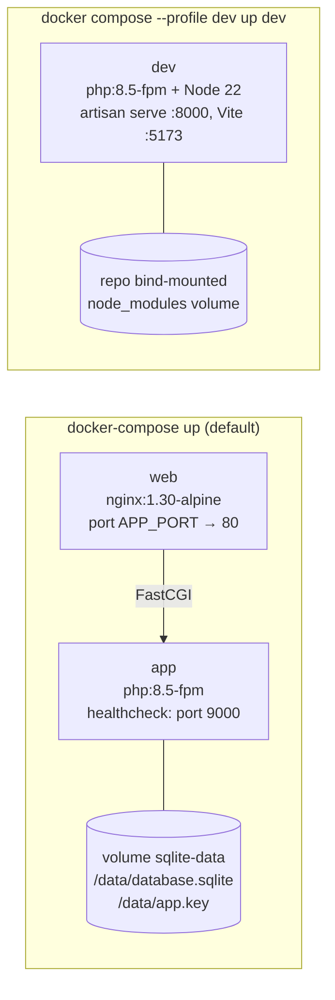
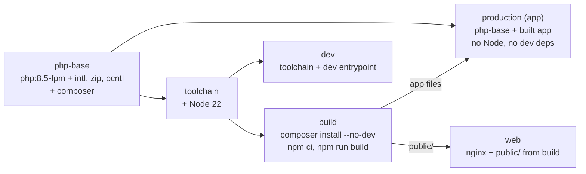
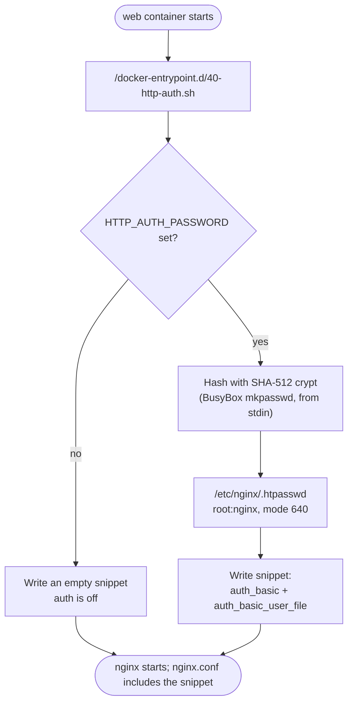
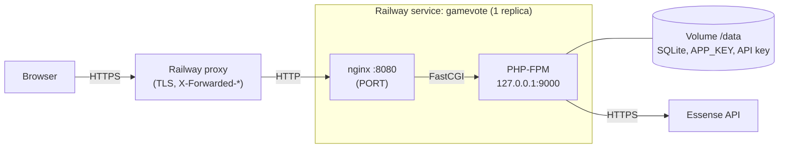

# Deployment

## Docker stacks

`docker-compose.yml` defines two production containers and an opt-in development container.



### How the production images are built



- The `web` image copies `public/` from the same `build` stage as `app`, so the assets always match.
- `app` starts with `docker/entrypoint.sh`: generate and persist `APP_KEY` if none is given, create
  the SQLite file, run migrations, `php artisan optimize`, then PHP-FPM.
- `web` waits for `app`'s healthcheck, so first-boot migrations don't produce 502s.

## Environment variables

| Variable              | Default                                     | Purpose                                                                           |
| --------------------- | ------------------------------------------- | --------------------------------------------------------------------------------- |
| `APP_PORT`            | `8000`                                      | Host port for the app (both stacks)                                               |
| `API_KEY_ESSENCE`     | empty                                       | Use this API key instead of a generated one                                       |
| `ESSENSE_API_URL`     | `https://codechallenge.essensedesigns.info` | API base URL                                                                      |
| `REMOVE_LIMITS`       | `false`                                     | Testing only: turn off the daily rule (ignored in production)                     |
| `HTTP_AUTH_USER`      | `gamevote`                                  | Username for HTTP basic auth (production stack)                                   |
| `HTTP_AUTH_PASSWORD`  | empty                                       | Turns on HTTP basic auth for the whole site when set (production stack)           |
| `DOCKER_APP_KEY`      | empty                                       | Supply `APP_KEY` to the production container instead of generating one            |
| `INERTIA_SSR_ENABLED` | `true`                                      | Inertia server-side rendering; tests set it off                                   |
| `UID` / `GID`         | `1000`                                      | User the dev container runs as, so files it writes are yours                      |
| `TRUSTED_PROXIES`     | empty                                       | Trust `X-Forwarded-*` headers from these proxies (`*` or IPs); set behind Railway |

The `app` container receives only `APP_*`, `DB_*`, `LOG_CHANNEL` and `API_KEY_ESSENCE`
explicitly, and `web` only `HTTP_AUTH_USER` and `HTTP_AUTH_PASSWORD`. `docker-compose` fills `${...}` values from a `.env` next to `docker-compose.yml`.

## Operating

| Task                                           | Command                                                       |
| ---------------------------------------------- | ------------------------------------------------------------- |
| Start                                          | `docker-compose up --build` → <http://localhost:8000>         |
| Add sample games                               | `docker-compose exec app php artisan games:seed --force`      |
| Logs                                           | `docker-compose logs -f app web`                              |
| Start fresh (new database and new API library) | `docker-compose down -v`                                      |
| Development with hot reload                    | `docker compose --profile dev up --build dev`                 |
| Tests in the dev container                     | `docker compose --profile dev run --rm dev ./vendor/bin/pest` |

`games:seed --force`: the stack runs with `APP_ENV=production`, where the command asks for
confirmation unless forced.

## HTTP basic auth

Setting `HTTP_AUTH_PASSWORD` in `.env` puts the whole production site (pages and assets) behind
a username and password.



- **Off by default,** so reviewers' `docker-compose up` needs no credentials.
- **The password is never stored or logged in plain text:** only the hash is written, and it is
  read from stdin so it doesn't appear in a process list.
- **Quote passwords in `.env` with single quotes.** Docker Compose treats `$` in `.env` as a
  variable: unquoted `pa$sword` silently becomes `pa`.
- **Use HTTPS in front of it** for anything beyond local use. Basic auth sends credentials with
  every request, encoded rather than encrypted.
- Changing the password takes effect on restart: `docker-compose up -d web`.

## Railway

Railway runs one container per service and doesn't run `docker-compose`, so the Dockerfile's
**final stage, `railway`**, runs nginx and PHP-FPM together. Railway always builds the last stage;
`docker-compose` names its `web`/`app` targets, so local use is unchanged.



- **Config:** `.railway/railway.ts` (Railway's Infrastructure as Code). Railway's older
  `railway.json`/`railway.toml` format stops being read on 2026-12-01.
- **Start-up:** `docker/railway-start.sh` runs the same first-boot setup as the `app` container
  (APP_KEY, SQLite, migrations, caches) and HTTP basic auth, then runs PHP-FPM and nginx. It exits
  if either dies, so Railway restarts the container, and stops both gracefully on `SIGTERM`.
- **One replica:** SQLite lives on the volume, and a Railway volume attaches to one service.
- **HTTPS:** `TRUSTED_PROXIES=*` makes Laravel honour Railway's `X-Forwarded-*` headers, so asset
  URLs, redirects and `Secure` cookies use https.
- **Health check:** `/up`, which nginx always exempts from basic auth.

### Deploying

```bash
railway login
railway init                # create the project (or `railway link` to an existing one)
railway config plan         # review what .railway/railway.ts would create
railway config apply        # create the service, volume and variables
```

Then, in the Railway dashboard:

1. **Settings → Networking → Generate Domain.** `APP_URL` uses `RAILWAY_PUBLIC_DOMAIN`, so it
   picks the domain up on the next deploy.
2. **Variables:** optionally set `HTTP_AUTH_USER` and `HTTP_AUTH_PASSWORD` (site password) and
   `API_KEY_ESSENCE`. Without an API key the app generates one and keeps it on the volume.
3. **Sample data (optional):** `railway ssh`, then `php artisan games:seed --force`.

## nginx

`docker/nginx.conf` follows Laravel's recommended config:

- **Routing:** `try_files $uri $uri/ /index.php?$query_string`; only `index.php` goes to PHP-FPM.
- **Hidden files** such as `.env` and `.htaccess` are denied (403).
- **`X-Powered-By`** is hidden.
- **Fingerprinted assets** (`/build/assets/`) are cached for a year as immutable.
