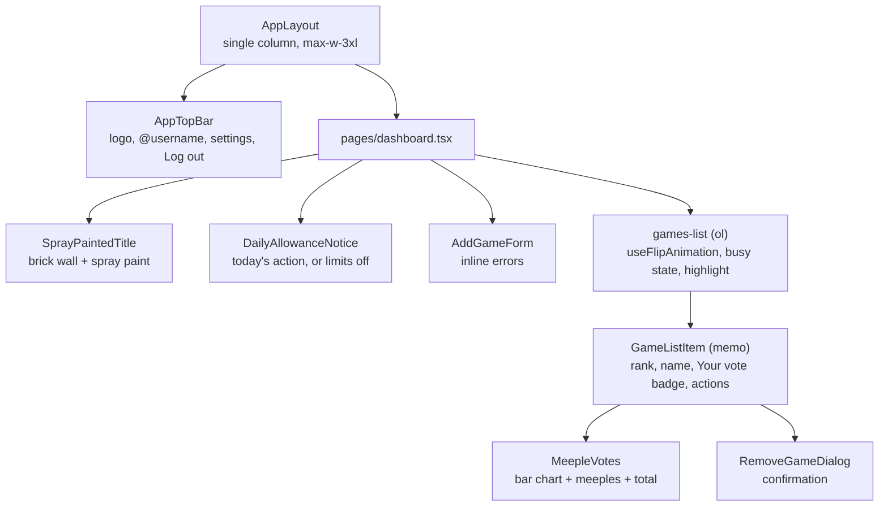
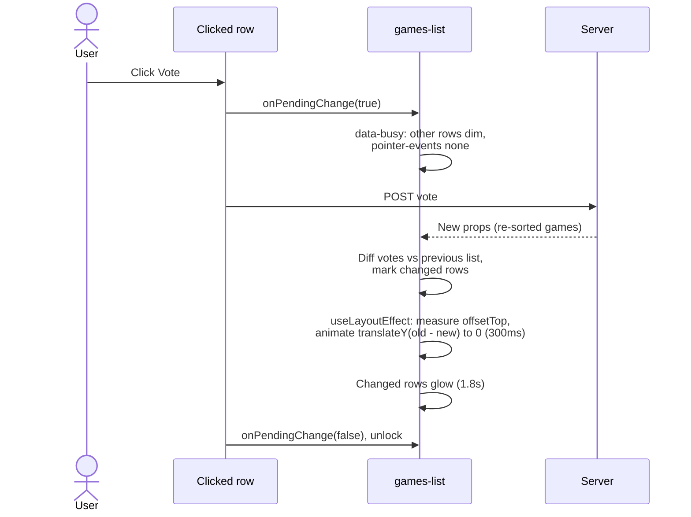

# Frontend

React 19 + TypeScript pages rendered through Inertia v3, styled with Tailwind 4 and the shadcn/ui
components from the Laravel starter kit. Built with Vite 8. Routes are called through
[Wayfinder](https://github.com/laravel/wayfinder)-generated functions, never hard-coded URLs.

## Page structure

Other states on the page: **empty library** ("No games yet") and **API unavailable** (message and
**Try again**, which reloads the page's data without a full page load).

## The vote bar chart

Each game row has a horizontal bar:

- **Track:** the full available width. "Your vote" sits on the title line and the vote buttons have
  a fixed width on desktop, so every track is the same width and equal votes get equal bars.
- **Fill:** `votes / most votes` of the track, in the title's spray colour (`--spray`: pink in light
  mode, green in dark). It animates when votes change. Any game with votes gets at least one
  meeple's width.
- **Meeples:** laid out in a single wrapping row inside the fill with `overflow: hidden`, so any
  meeple that doesn't fit wraps onto a hidden second line. The fill only ever shows whole meeples,
  never more than the votes, and at most 20 are rendered.
- **Total:** the exact count, right-aligned in its own space so a full bar never runs under it.
- **Accessibility:** the bar is `role="img"` with an `aria-label` such as "13 votes".
- **Phones:** the track ends exactly where the Vote button ends.

## Re-sorting without confusion

After a vote the list re-sorts. Done instantly, rows jump under the cursor, and a user can believe
their vote went to the wrong game. Three things prevent that:

- **Slide (FLIP):** `useFlipAnimation` records each row's `offsetTop` after every reorder and uses
  the Web Animations API to slide rows from their old position. Skipped for users who prefer
  reduced motion.
- **Glow:** rows whose vote count changed, or that are new, get a background fade. Two identical
  keyframes (`row-changed-a/b`) alternate so the same row can glow on consecutive changes.
- **Pending lock:** CSS on the list (`.games-list[data-busy] > li:not([data-pending])`), so locking
  and unlocking doesn't re-render any rows.

## Performance

Measured on the production build with ~450 games (games had 0–5 votes):

| Version                                             | Browser work per vote | of which JavaScript | of which layout + style |
| --------------------------------------------------- | --------------------- | ------------------- | ----------------------- |
| Before optimising                                   | ~230ms                | —                   | —                       |
| Memoised rows, CSS lock, stable refs, 20-meeple cap | ~145ms                | 12ms                | 133ms                   |
| Plus `content-visibility: auto` on rows             | **~95ms**             | 12ms                | 84ms                    |

- **Rows are memoised** with a comparison on the game's fields, because the server sends new
  objects for every game after each request.
- **`useFlipAnimation` returns a stable ref callback per key**, so refs don't defeat the memo.
- **`content-visibility: auto`** lets the browser skip layout for rows scrolled out of view.
- **No pagination:** the API always returns the whole list (no paging endpoint), the duplicate check
  needs it anyway, and a vote could move a game onto another page. Responsiveness stays under
  ~100ms per vote up to roughly 450 games.

## Global error handling

`resources/js/app.tsx` listens for Inertia's `networkError` and `httpException` events and shows a
toast ("Couldn't reach the server…", session expired, too many requests, server error) instead of
failing silently. In development, Laravel's error page is kept.

## Design tokens

| Token            | Use                                                        |
| ---------------- | ---------------------------------------------------------- |
| `--font-spray`   | "Rubik Spray Paint", self-hosted by the Vite font plugin   |
| `--spray`        | Paint colour for the title, bar fills and change glow      |
| `.graffiti-wall` | Brick pattern (inline SVG, one per theme) behind the title |
