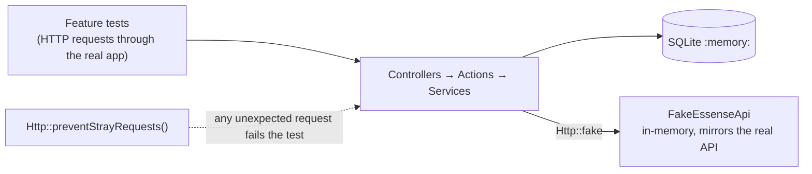

# Testing

Pest 5, run with `composer test` (Pint, PHPStan, Pest) or `composer ci:check` (plus front-end
format, lint and TypeScript). The suite runs against an in-memory SQLite database.

## Strategy

- **Feature tests first:** most tests make real HTTP requests through routes, middleware,
  validation, actions and the database, and assert both the response and the stored state.
- **No real network:** `tests/TestCase.php` calls `Http::preventStrayRequests()`, and
  `phpunit.xml` points the client at `https://essense.test` with the key `test-key`.
- **A faithful fake:** `tests/FakeEssenseApi.php` reproduces the real API's quirks so tests fail
  for the same reasons production would:
    - form-encoded bodies, `MISSING_KEY` / `INVALID_KEY` errors
    - HTTP 200 placeholders (`{}`, `{"success": false}`, `{"id": -1}`)
    - unsorted lists, ids never reused, votes floored at zero
    - `api-key/generate`, and `restart()` to simulate the server restarting (all keys invalid, ids
      start over)
    - `unreachable()` for connection failures
- **Environment pinned:** `phpunit.xml` sets `REMOVE_LIMITS=(false)` and
  `INERTIA_SSR_ENABLED=(false)` so a local `.env` or a running Vite server can't change results.

## What each file covers

| File                         | Covers                                                                                                                                                        |
| ---------------------------- | ------------------------------------------------------------------------------------------------------------------------------------------------------------- |
| `Games/EssenseClientTest`    | Form encoding and key, placeholder handling, error codes, malformed data, read-only retries                                                                   |
| `Games/GameLibraryTest`      | Sorting by votes then name, "your vote" marking, API down, rejected `.env` key, allowance status                                                              |
| `Games/AddGameTest`          | Adding spends the allowance, duplicates by case/spacing, the daily limit, validation, API failure rollback, local midnight in Sydney, guests                  |
| `Games/VoteTest`             | Voting, once per day, next day, once per game, missing game, rollback, same-day refund, earlier-day no refund, others' votes, API failure on removal          |
| `Games/RemoveGameTest`       | Anyone can remove, votes discarded, same-day refunds, earlier days kept, already gone, API failure                                                            |
| `Games/ApiKeyTest`           | Generating and encrypting a key, reuse, `.env` precedence, not replacing a rejected `.env` key, replacing after a restart, local reset only on library change |
| `Games/RemoveLimitsTest`     | Unlimited actions, duplicates and one-vote-per-game still enforced, page notice, ignored in production                                                        |
| `Games/SeedGamesCommandTest` | Defaults, options, skipping existing titles, invalid options, API down, production guard                                                                      |
| `Auth/*`                     | Username login (case-insensitive), registration rules and timezone capture, removed email routes, 2FA, password confirmation                                  |
| `Settings/*`                 | Profile updates (username lowercasing and uniqueness), password, security page                                                                                |

## Checking the tests themselves

Key rules were deliberately broken one at a time to confirm a test fails for each:

- same-day refund removed, refund ignoring the date
- duplicate check made case-sensitive
- user timezone ignored
- rollback on API failure removed
- old actions refunded on game removal, timezone not saved
- local votes never reset, or reset on every request
- no key replacement, or replacing the `.env` key
- generating a key on every request, storing the key unencrypted
- the `REMOVE_LIMITS` production guard removed

Every one was caught.

## Browser checks

UI behaviour was verified with headless Chrome driven over the DevTools protocol, logged in as a
separate test account:

- layout at phone and desktop widths, light and dark mode
- every vote bar within its Vote button on phones, and equal track widths
- the posted game id matching the clicked row, including during re-sorts and fast second clicks
- rows sliding, the changed row glowing, other rows locking while a request is pending
- per-vote performance at 97, 233 and ~450 games
